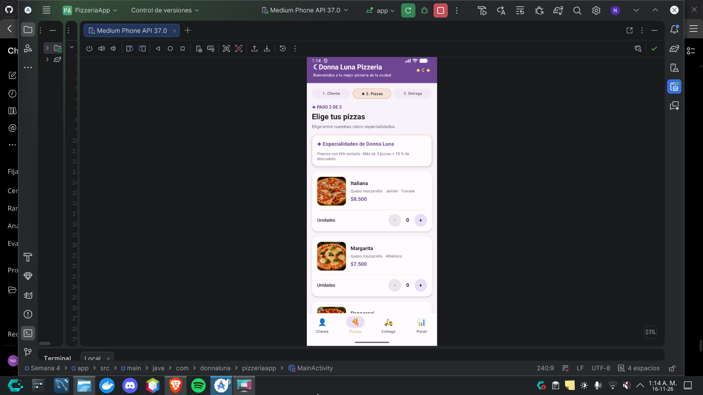

<div align="center">

# 🍕 DONNA LUNA · PIZZERÍA

### Desarrollo App Móviles I · PMY2201 · Semana 4

**Aplicación Android en Kotlin para registrar pedidos de pizzas, gestionar inventario, aplicar promociones y supervisar las entregas desde un emulador.**

*Kotlin · Android Studio · Jetpack Compose · Material 3 · POO · Gradle · AVD*

[📁 Repositorio DonnaLunaPizzeria](https://github.com/LadyRed145/DonnaLunaPizzeria) · [📖 Documentación de Semana 3](../../Semana%203/README.md)

</div>

---

## ✦ Visión general

**Donna Luna Pizzería** es la adaptación a **Android** de la aplicación de consola desarrollada durante las Semanas 1, 2 y 3. En esta cuarta etapa se creó **`PizzeriaApp`** en Android Studio y se integró la lógica existente de Kotlin en una interfaz móvil construida con **Jetpack Compose y Material 3**.

El proyecto conserva el catálogo de cinco pizzas, los importes calculados con `BigDecimal`, el inventario por ingredientes, los descuentos, los repartidores y los estados de pedido. La presentación se reorganizó en **cuatro pestañas** y se añadieron imágenes ilustrativas de las pizzas, tarjetas, indicadores de estado y barras de inventario.

**Es una simulación académica:** no procesa pagos reales, no usa GPS ni geolocalización, no envía correos y no persiste pedidos en una base de datos. Las operaciones se realizan localmente y los registros de la jornada se mantienen en memoria mientras la aplicación permanece activa.

| 👤 Cliente | 🍕 Pizzas | 🛵 Entrega | 📊 Panel |
|:---:|:---:|:---:|:---:|
| Datos y validaciones | Catálogo, fotos y cantidades | Zona, promoción y confirmación | Pedido, jornada e inventario |

### Funcionalidades implementadas

- 👤 Registro de **nombre y dirección obligatorios**, con teléfono y correo opcionales.
- 🍕 Catálogo de **cinco pizzas**, con fotografías ilustrativas integradas en los recursos locales y controles `+` / `−`.
- 🛒 Selección de **1 a 100 pizzas por pedido**, con reglas de cantidades compartidas por interfaz, dominio e inventario.
- 💰 Precios en pesos chilenos; descuento del **10 % cuando se superan tres pizzas** e **IVA del 19 % incluido**.
- 📅 Promoción demostrativa del **5 %**, vigente del **1 al 30 de noviembre de 2026**, únicamente en productos elegibles.
- 📦 Validación del inventario antes de confirmar y descuento de ingredientes solo cuando hay stock suficiente.
- 🛵 Zona de reparto **Centro, Norte o Costa**, asignación simulada de repartidores y seguimiento por estados.
- 📊 Panel con resumen del pedido, reporte de jornada y existencias por ingrediente.
- 🌙 Presentación con tonos morados y acentos cálidos, detalles visuales discretos y navegación inferior.

---

## 📱 Interfaz Android

La pantalla principal usa **cuatro pestañas** y organiza el registro en tres pasos consecutivos:

| Vista | Función | Elementos principales |
|---|---|---|
| 👤 **Cliente** | Paso 1 | Nombre, dirección, teléfono y correo |
| 🍕 **Pizzas** | Paso 2 | Fotografías, ingredientes, precios y cantidades |
| 🛵 **Entrega** | Paso 3 | Zona, notas, fecha promocional y confirmación |
| 📊 **Panel** | Seguimiento | Pedido, reporte del día y stock disponible |

La aplicación muestra el mensaje solicitado en la actividad:

> **Bienvenidos a la mejor pizzería de la ciudad**

### Evidencias de funcionamiento

Las capturas se encuentran en [`evidencias/`](evidencias/). Entre ellas se documentan Android Studio, la ejecución de Donna Luna, el registro de pedidos y la configuración del AVD.

<div align="center">



*Catálogo ejecutado en Android Studio; las pizzas también tienen imágenes locales dentro de la aplicación.*

</div>

| Archivo | Evidencia |
|---|---|
| `01_android_studio.png` | Android Studio abierto con el proyecto |
| `02_pizzas.png` | Menú, fotografías y controles de cantidad |
| `03_entregas.png` | Datos de entrega y confirmación |
| `04_panel.png` | Detalle del pedido y seguimiento |
| `05_jornada.png` | Reporte de la jornada |
| `06_configuracion_AVD.png` | Dispositivo virtual configurado en Android Studio |

---

## 🍕 Catálogo de pizzas

El catálogo se mantiene en `app/src/main/java/servicios/CatalogoPizzas.kt`. Las imágenes ilustrativas se almacenan en `app/src/main/res/drawable-nodpi/` y **no requieren conexión a internet**.

| N.º | Pizza | Precio unitario | Ingredientes de demostración |
|---:|---|---:|---|
| 1 | Italiana | $8.500 | Masa, salsa, mozzarella, jamón y tomate |
| 2 | Margarita | $7.500 | Masa, salsa, mozzarella y albahaca |
| 3 | Pepperoni | $9.500 | Masa, salsa, mozzarella y pepperoni |
| 4 | Cuatro Quesos | $10.500 | Masa, salsa, mozzarella, cheddar, azul y parmesano |
| 5 | Hawaiana | $9.000 | Masa, salsa, mozzarella, jamón y piña |

Los ingredientes se muestran desde el **catálogo real**; las cantidades de consumo son unidades didácticas de inventario, no recetas comerciales. Las cinco imágenes son **ilustraciones generadas con apariencia fotográfica**, no fotografías de productos vendidos realmente.

---

## 🛒 Pedidos, inventario y promociones

### Cálculos monetarios

La lógica de importes permanece en `modelo/Pedido.kt`, con utilidades de redondeo en `utils/Calculos.kt`:

| Concepto | Regla |
|---|---|
| Subtotal | Precio unitario × cantidad, acumulado por variedad |
| Volumen | **10 %** si el total supera **3 pizzas** |
| Promoción por fecha | **5 %** sobre pizzas elegibles dentro de la vigencia |
| Orden | Primero volumen; después promoción sobre el importe elegible restante |
| IVA | **19 % incluido** en el precio y el total; no se agrega nuevamente |
| Precisión | `BigDecimal`, redondeo `RoundingMode.HALF_UP` |

Los productos promocionables son **Margarita, Pepperoni y Cuatro Quesos**. La selección se determina mediante la anotación `@Promocionable` y **reflection** sobre miembros del catálogo y de `SeleccionEspecial`.

### Inventario y reparto

- `InventarioService` inicializa **20 porciones por ingrediente** y calcula los requerimientos conjuntos de todo el pedido.
- Si alcanza el stock, confirma y descuenta ingredientes; si falta alguno, rechaza **sin descontar parcialmente**.
- `RepartidorService` considera las zonas simuladas **Centro, Norte y Costa** y la disponibilidad de sus repartidores.
- `JornadaService` registra pedidos con identificadores consecutivos a partir de **1001** y clasifica la jornada en **pendientes, completados y rechazados**.
- `EstadoPedido` administra el ciclo **En preparación → Listo → En camino → Entregado**; los estados finales no permiten nuevos avances.
- El panel representa existencias mediante **barras de disponibilidad**, y muestra subtotal, descuentos, IVA y total del último pedido.

La cercanía del repartidor se resuelve por prioridades de zona, **sin GPS**. La aplicación está enfocada en la simulación local, no en un despacho conectado a servicios externos.

---

## ✅ Validaciones y mejoras de Semana 4

Se conservaron las reglas de Kotlin avanzado de la Semana 3 y se incorporaron las oportunidades de mejora señaladas en la retroalimentación docente.

| Mejora | Implementación |
|---|---|
| **Correo electrónico** | Regex de etiquetas DNS: no acepta guiones al inicio o final de etiquetas ni extensiones numéricas; exige TLD alfabético |
| **Fechas** | `DateTimeFormatter` explícito con `ResolverStyle.STRICT`, formato `AAAA-MM-DD` y constantes compartidas |
| **Cantidades** | `esCantidadValida()` y `esCantidadTotalValida()` para reutilizar límites de **1–100** entre interfaz, pedido e inventario |
| **Mensajes** | Avisos de correo, fecha, vigencia y cantidades reunidos en `utils/Constantes.kt` |

### Casos de validación documentados

Estos casos describen el **comportamiento esperado** de las reglas. No constituyen por sí solos una suite automatizada de pruebas Android.

| Dato | Ejemplo | Resultado esperado |
|---|---|---|
| Correo válido | `cliente@ejemplo.cl` | Aceptar |
| Subdominio válido | `cliente@ventas.ejemplo.com` | Aceptar |
| Dominio con guion inicial | `cliente@-ejemplo.cl` | Rechazar y explicar el formato |
| Dominio con guion final | `cliente@ejemplo-.cl` | Rechazar y explicar el formato |
| Extensión numérica | `cliente@ejemplo.123` | Rechazar |
| Fecha válida en promoción | `2026-11-15` | Fecha válida; evaluar elegibilidad |
| Fecha imposible | `2026-02-30` | Rechazar |
| Fecha válida fuera de promoción | `2026-12-01` | Aceptar fecha, sin promoción |
| Cantidad 0 | `0` | Rechazar pedido vacío |
| Cantidad mínima | `1` | Aceptar validación de cantidad |
| Cantidad máxima | `100` | Aceptar cantidad; comprobar stock por separado |
| Cantidad fuera de rango | `101` | Rechazar |

**Importante:** que una cantidad sea válida no garantiza stock suficiente. El inventario se comprueba por separado antes de confirmar el pedido.

---

## 🧩 Arquitectura Android y Kotlin

Se conserva una separación entre la **interfaz Compose**, los **modelos de dominio**, los **servicios** y las **utilidades compartidas**.

| Componente | Responsabilidad |
|---|---|
| `MainActivity.kt` | Punto de entrada Android, pantallas Compose y estados de la interfaz |
| `modelo/` | `Cliente`, `Producto`, `Pedido`, `EstadoPedido`, `Repartidor` y clases relacionadas |
| `servicios/` | Catálogo, inventario, jornada, promociones, registro de clientes y repartidores |
| `utils/` | Constantes, validaciones, fechas, cálculos e importes |
| `anotaciones/` | `@Promocionable` |
| `res/drawable-nodpi/` | Fotografías ilustrativas de las cinco pizzas |
| `evidencias/` | Capturas de configuración y ejecución |
| `gradle/` y archivos `*.gradle.kts` | Configuración y dependencias del proyecto Android |

### Estructura principal del repositorio

```text
DonnaLunaPizzeria/
├── Semana 1/
├── Semana 2/
├── Semana 3/
└── Semana 4/
    └── PizzeriaApp/
        ├── README.md
        ├── app/
        │   ├── src/main/java/
        │   │   ├── com/donnaluna/pizzeriaapp/MainActivity.kt
        │   │   ├── modelo/
        │   │   ├── servicios/
        │   │   ├── utils/
        │   │   └── anotaciones/
        │   ├── src/main/res/drawable-nodpi/
        │   └── build.gradle.kts
        ├── gradle/
        ├── evidencias/
        ├── build.gradle.kts
        ├── settings.gradle.kts
        ├── gradle.properties
        └── gradlew
```

Las Semanas 1, 2 y 3 se mantienen **independientes**; esta versión Android no reemplaza ni sobrescribe sus entregas.

---

## ▶️ Instalación y ejecución

### Requisitos y configuración utilizada

- **Android Studio** con soporte para Kotlin, Jetpack Compose y Android SDK.
- **Compile SDK y Target SDK:** API **37**.
- **Minimum SDK:** API **24** (cumple la instrucción de API 21 **o superior**).
- **Emulador de pruebas:** `Medium Phone API 37.0`.
- **Gradle Wrapper:** versión **9.9.0** incluida en el proyecto.
- **Java:** compatibilidad de código configurada en Java 11; `coreLibraryDesugaring` habilitado para APIs de `java.time`.

### Desde Android Studio

1. Abrir la carpeta **`PizzeriaApp/`**, que contiene `settings.gradle.kts`, `gradlew` y `app/`.
2. Esperar la sincronización de Gradle y permitir la descarga de dependencias necesarias.
3. Iniciar el dispositivo virtual desde **Device Manager** (o elegir otro dispositivo compatible).
4. Seleccionar la configuración **`app`** y pulsar **Run ▶**.
5. Registrar un cliente, elegir pizzas, confirmar el pedido y revisar las pestañas de seguimiento, jornada y stock.

### Compilación desde una terminal Fish

Ubicándose en la **raíz del proyecto Android**:

```fish
./gradlew :app:assembleDebug
```

Este comando compila el APK de depuración. Para **abrir y utilizar la interfaz**, se recomienda ejecutarla desde Android Studio en el emulador configurado. No se requiere `npm`, un servidor web ni conexión con una base de datos.

---

## 🔄 Flujo funcional

```text
Abrir Donna Luna en Android
          ↓
👤 Cliente → registrar y validar datos
          ↓
🍕 Pizzas → seleccionar variedades y cantidades
          ↓
🛵 Entrega → zona, notas y promoción opcional
          ↓
¿Datos válidos y pedido con 1–100 pizzas?
    ├── No → Mostrar aviso de corrección
    └── Sí
          ↓
¿Inventario suficiente?
    ├── No → Pedido rechazado sin descontar stock
    └── Sí → Descontar ingredientes y asignar repartidor disponible
          ↓
📊 Panel → importes, estados, jornada e inventario
          ↓
En preparación → Listo → En camino → Entregado
```

---

## 🧪 Comprobación funcional

Las evidencias adjuntas documentan el funcionamiento de la aplicación en el **emulador de Android Studio**. Durante las pruebas manuales se observaron el ingreso de datos, la selección de pizzas, el cálculo de descuentos, el descuento de ingredientes, la confirmación de pedidos y el avance hasta **Entregado**.

Las pruebas predeterminadas de la plantilla Android se conservan en `app/src/test/` y `app/src/androidTest/`. **No se declara cobertura automatizada adicional** para esta entrega. Los casos de frontera anteriores se incluyen como documentación técnica de las restricciones.

---

## 📌 Alcance de la entrega

**Implementado:** configuración de Android Studio y AVD; proyecto Kotlin Android funcional; interfaz Jetpack Compose; integración de modelos y servicios anteriores; validaciones reforzadas; cinco pizzas con imágenes locales; promociones y descuentos; inventario, repartidores, estados de pedido y reporte diario; seis capturas de evidencia.

**Fuera de alcance:** pago real, emisión tributaria, ubicación GPS, servicios de mapas, persistencia entre sesiones, notificaciones externas, envíos reales de correo y una infraestructura de producción.

La actividad de Semana 4 se entrega como **proyecto Android en ZIP/RAR**, incluyendo la documentación visual de configuración y funcionamiento. Este README acompaña la publicación en GitHub y conserva la continuidad documental de las semanas anteriores.

---

<div align="center">

### 🌙🍕 Donna Luna · Pizzería

**Desarrollo App Móviles I · PMY2201 · Semana 4**

Natalia Alvarado · 2026

</div>
